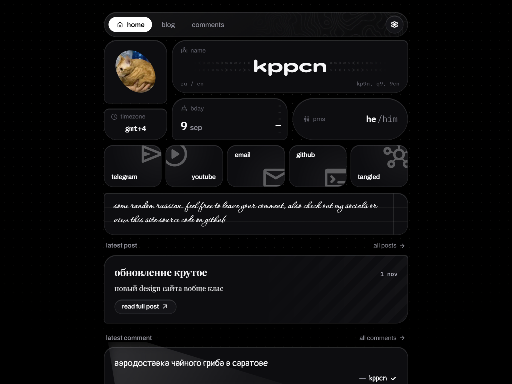

<div align="center">


# kppcn.cyou

simple personal bio, blog & comment engine

<br>

[](https://rust-lang.org)
[](https://htmx.org)
[](https://redb.org)
[](https://kdl.dev)
[](LICENSE)

</div>

---

### features
- comments and blog system
- custom captcha system
- customizing via admin page

---

### quickstart

```bash
# 1. copy config
cp config.example.kdl config.kdl

# 2. generate two keys for voter-hash-salt and secret (run twice)
openssl rand -hex 32

# 3. build & run
cargo run --release
```

> configure `admin.username`, `admin.password`, and generated secrets inside `config.kdl` prior to first launch.

---

### configuration

| parameter | description |
| :--- | :--- |
| `server.port` | listener port |
| `server.static-dir` | static assets directory |
| `server.db-path` | path to local `redb` database file |
| `server.settings-path` | json path for live contacts/emojis editing |
| `admin.username` / `password` | credentials for admin panel and endpoints |
| `captcha.enabled` | toggle proof-of-work challenge |
| `captcha.base_difficulty` | leading zero bits difficulty target |
| `captcha.ttl` | challenge validity timeframe (seconds) |
| `security.voter-hash-salt` | salt for anonymized vote tracking |
| `security.enable-hsts` | sets `Strict-Transport-Security` (https only) |
| `account.secret` | identity cookie signing key |
| `account.secure-cookies` | forces `Secure` flag on cookies (https only) |
